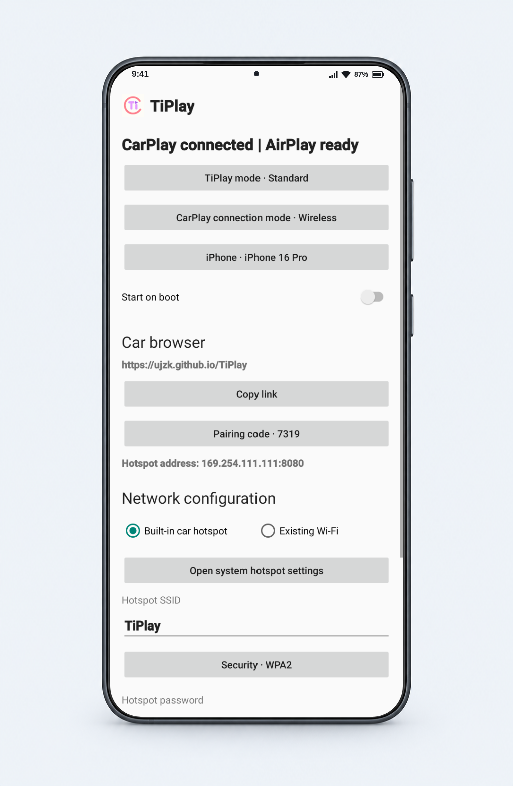
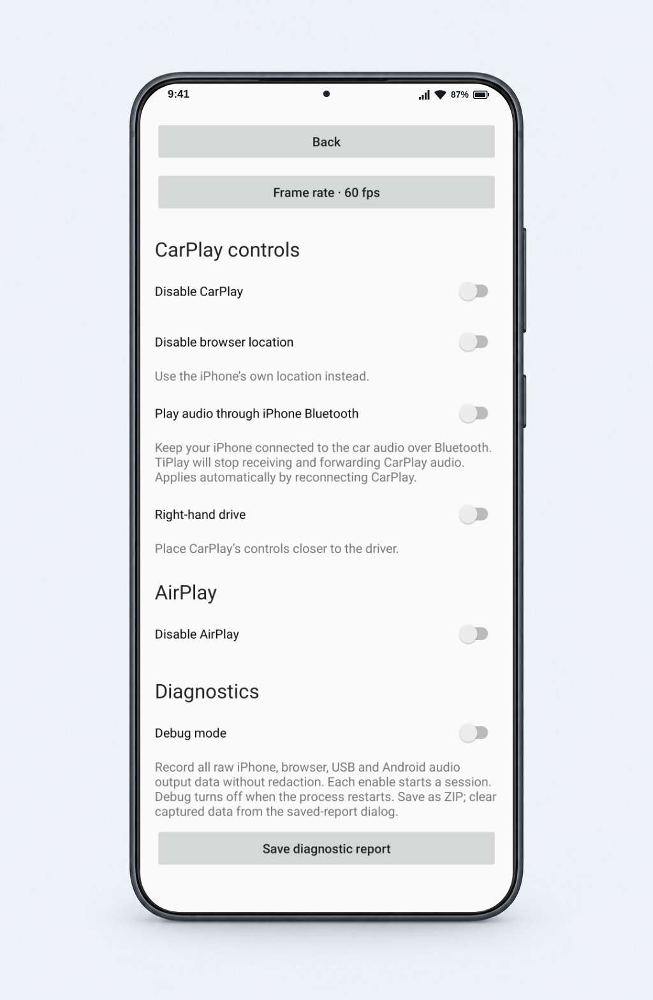
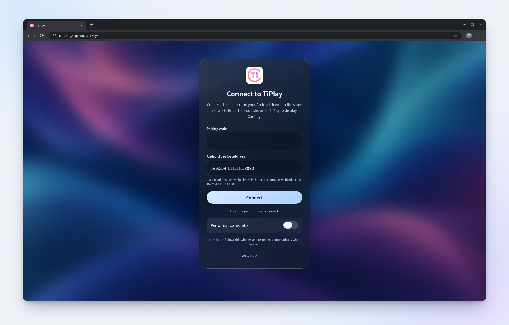
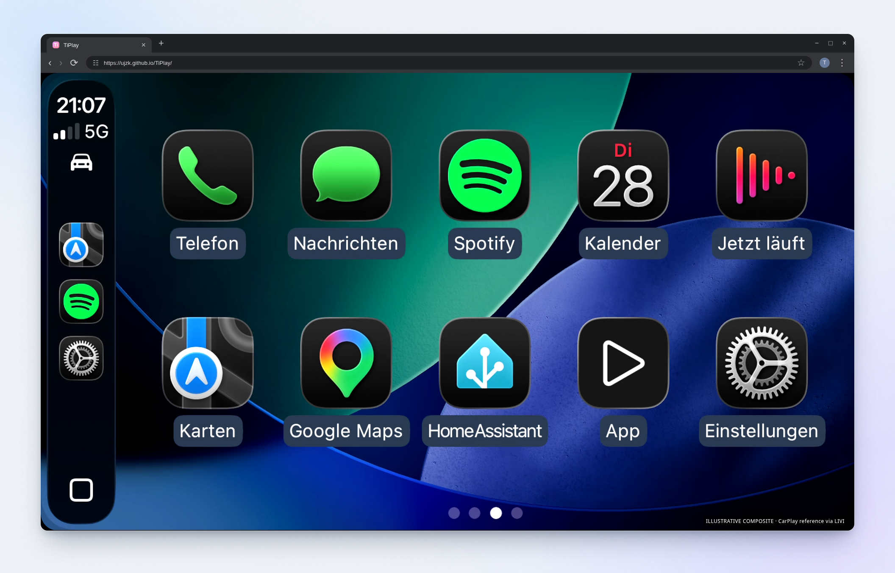

<p align="center"></p>

<h1 align="center">TiPlay</h1>

<p align="center"><strong>CarPlay in your car’s browser, powered by an Android phone.</strong></p>

<div align="center">
<a href="https://github.com/uJZk/TiPlay/actions/workflows/android.yml"></a> <a href="https://github.com/uJZk/TiPlay/releases/tag/v0.2.20-beta.1"></a> <a href="LICENSE"></a> 
</div>

<p align="center"><a href="https://github.com/uJZk/TiPlay/releases">Download APK</a> · <a href="https://ujzk.github.io/TiPlay/">Open browser player</a> · <a href="docs/README.md">Documentation</a></p>

<p align="center">🇺🇸 <a href="README.md">English</a> · 🇨🇳 <a href="README.zh-CN.md">简体中文</a></p>

[Overview](#overview) · [Features](#features) · [Screenshots](#screenshots) · [Installation](#installation) · [Usage](#usage) · [Help](#help-and-documentation) · [Contributing](#contributing) · [License](#license-and-credits)

## Overview

TiPlay turns an Android phone into a receiver for your iPhone’s CarPlay session. The iPhone connects to Android over USB or wireless CarPlay; TiPlay relays the picture to the car’s browser, where you control it by touch.

The supported product is **Android phone + car browser**. Native Android head units are outside its scope.

## Features

- **Car-browser location for navigation** — obtain location from the car browser, automatically identify its coordinate system and convert GCJ-02 to WGS84 when needed before forwarding it to the iPhone.
- **Resilient browser playback** — bounded buffering, clock synchronization and continuous audio resampling help absorb network jitter and keep audio/video in sync.
- **Direct audio/video decoding in the browser** — decode CarPlay audio/video directly in the browser, without an extra transcoding stage.
- **USB and wireless CarPlay** — connect the iPhone to the Android phone by cable or wirelessly.
- **Browser touch control** — operate CarPlay from the car’s browser.
- **Adaptive display** — adjust to the browser window and automatically select HEVC or H.264.
- **Music, calls and Siri** — play music in the browser and use the car’s Bluetooth for calls and Siri.

## Screenshots

| Android · Main settings | Android · Advanced settings |
| :---: | :---: |
|  |  |

| Browser · Pair and connect | Browser · CarPlay illustration |
| :---: | :---: |
|  |  |

The Android images render the actual app views in a simulated normal-use state. The browser connection page is captured in Chromium; the CarPlay view is an **illustrative composite** using a LIVI reference, with a 1920 × 1080 picture filling the content area. Frames and the Android status bar are presentation artwork. These images do not document a live vehicle test. [Android image sources](site/assets/screenshots/Android-sources.md) · [Browser image sources](site/assets/screenshots/Browser-sources.md).

## Installation

### What you need

| Device | Requirement | Role |
| --- | --- | --- |
| Android phone | Android 9 or later | Runs TiPlay and receives CarPlay |
| iPhone | CarPlay enabled | Supplies the CarPlay session |
| Car browser | WebCodecs support and local-network access to Android | Displays the picture and sends touch input |

Use an Android hotspot or an existing Wi-Fi network that allows devices to communicate. The first visit to the HTTPS player requires internet access. Tesla browsers may need an [additional hotspot address](docs/Hotspot-address.md).

### Connect for the first time

1. **Install while parked.** Download the APK from [Releases](https://github.com/uJZk/TiPlay/releases), install it on the Android phone and open TiPlay. Complete the permission checklist for the features you use.
2. **Connect the iPhone.** For wireless CarPlay, pair it with Android over Bluetooth. For USB, use a data-capable cable and approve the requested device dialogs.
3. **Configure TiPlay.** In **Main settings**, select the iPhone and CarPlay connection mode, then configure **Android hotspot** or **Existing Wi-Fi**. Turn on the hotspot or join Wi-Fi in Android’s system settings.
4. **Open the car browser.** Connect the car to the same network and open [ujzk.github.io/TiPlay](https://ujzk.github.io/TiPlay/), or use the pairing link shown by TiPlay.
5. **Pair the browser.** Enter the Android address and four-digit pairing code shown by TiPlay, allow local-network access if prompted, and select **Connect**.

For detailed USB, network and permission instructions, see [Install and connect](docs/Install.md) and [Connection setup](docs/Connection-setup.md).

> [!IMPORTANT]
> TiPlay is experimental and is not Apple-certified. Compatibility varies with the iPhone, browser and vehicle. See the [testing boundaries](docs/Testing.md) and [remaining work](docs/Todo.md).

## Usage

### Controls and settings

| Goal | Where to go |
| --- | --- |
| Choose the iPhone, connection mode or network | Android **Main settings** |
| Change video, audio, AirPlay or diagnostics options | **Advanced settings** |
| Open the browser portal during CarPlay | Tap the **TiPlay** icon in CarPlay |
| Change the phone endpoint after its address or port changes | Select **Disconnect**, edit **Android address**, then **Connect**, or open the updated pairing link |

Valid settings save automatically. Changes that need a new connection trigger reconnection; **Disable CarPlay** stops startup and retries. **Start on boot** remains subject to Android’s background restrictions and does not enable the hotspot.

### Music, calls and Siri

Music normally plays in the browser. Calls and Siri through TiPlay need the Android phone paired with the car’s Bluetooth telephone profile, plus Android microphone permission.

To use the iPhone’s direct Bluetooth audio connection instead, enable **Advanced settings → Disable CarPlay audio**, pair the iPhone with the car and select it for audio and calls. [Audio setup](docs/Install.md#set-up-sound).

### AirPlay

AirPlay supports mirroring, photos and compatible unprotected media and has been verified. It starts by default and can be disabled in **Advanced settings**. Formats, limitations and connection details are documented in [AirPlay](docs/AirPlay.md).

## Help and documentation

If something fails, reproduce it and use **Advanced settings → Save diagnostic report**. Review the report for private information, then attach it to a [GitHub issue](https://github.com/uJZk/TiPlay/issues) with your device/software versions and reproduction steps. Reports are not uploaded automatically; exclude hotspot passwords.

| Topic | Guide |
| --- | --- |
| Pairing, picture, browser controls and reconnecting | [Car browser](docs/Browser.md) |
| Tesla reachability and hotspot address methods | [Hotspot address](docs/Hotspot-address.md) |
| Reports and stored information | [Diagnostics](docs/Diagnostics.md) · [Privacy](docs/Privacy.md) |
| All guides and release history | [Documentation index](docs/README.md) · [Changelog](CHANGELOG.md) |

## Contributing

Start with [AGENTS.md](AGENTS.md) and the [build guide](docs/Build.md). They define the supported product, toolchain, source checks and device-validation limits. For a bug report or proposal, use [Issues](https://github.com/uJZk/TiPlay/issues).

<details>
<summary>Build the Android phone app from source</summary>

With the documented JDK and Android SDK configured, run from the repository root:

```sh
./gradlew :mobile:assembleDebug
```

The APK is written to `mobile/build/outputs/apk/debug/mobile-debug.apk`. Ordinary source builds do not contain accessory identity assets; standalone CarPlay requires those inputs separately. Follow the [build guide](docs/Build.md#runtime-identity) rather than placing credentials in source.

</details>

## License and credits

TiPlay builds on receiver work from [DiPlay](https://github.com/shihabal3amri/DiPlay) and [xcertplay](https://github.com/shilapi/xcertplay), licensed under [GPL-3.0](LICENSE). The [third-party notices](docs/Third-party-notices.md) record component licenses, assets and provenance.

CarPlay and other depicted brands belong to their respective owners. TiPlay is not affiliated with Apple, Tesla or BYD.
