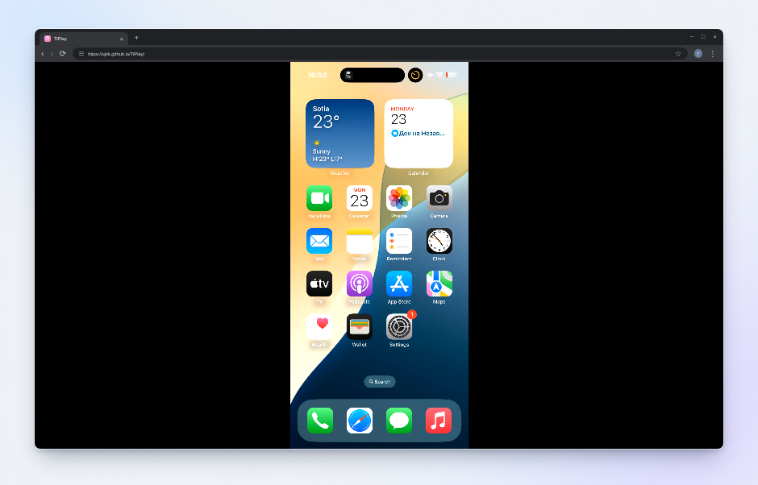
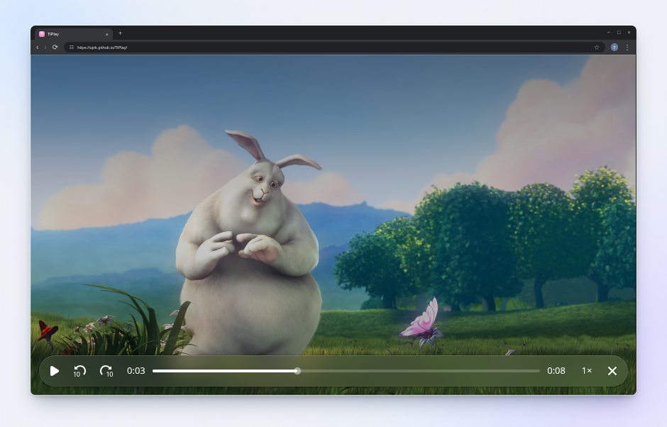

<p align="center"></p>

<h1 align="center">TiPlay</h1>

<p align="center"><strong>用安卓手机，在车载浏览器里使用 CarPlay。</strong></p>

<div align="center">
<a href="https://github.com/uJZk/TiPlay/actions/workflows/android.yml"></a> <a href="https://github.com/uJZk/TiPlay/releases/tag/v0.2.20-beta.24"></a> <a href="LICENSE"></a> 
</div>

<p align="center"><a href="https://github.com/uJZk/TiPlay/releases">下载 APK</a> · <a href="https://ujzk.github.io/TiPlay/">打开浏览器播放器</a> · <a href="docs/README.md">文档目录</a></p>

<p align="center">🇺🇸 <a href="README.md">English</a> · 🇨🇳 <a href="README.zh-CN.md">简体中文</a></p>

[项目介绍](#项目介绍) · [功能列表](#功能列表) · [界面展示](#界面展示) · [安装与连接](#安装与连接) · [日常使用](#日常使用) · [帮助](#帮助与文档) · [参与开发](#参与开发) · [许可证](#许可证与致谢)

## 项目介绍

TiPlay 让安卓手机接收 iPhone 的 CarPlay 会话。iPhone 通过 USB 或无线 CarPlay 连接安卓手机，TiPlay 再将画面送到车载浏览器，直接触摸网页即可操作。

本项目支持的产品形态为**安卓手机＋车载浏览器**，不支持原生安卓车机。

## 功能列表

- **USB 与无线 CarPlay**：支持数据线连接或无线连接 iPhone 与安卓手机。
- **AirPlay**：在浏览器中进行屏幕镜像、查看照片和播放兼容的非 DRM 媒体。
- **车机定位协同**：获取车载浏览器定位，自动判别坐标系，按需将 GCJ-02 还原为 WGS84，再转发给 iPhone。
- **音视频抗网络波动**：网页端通过有界缓冲与音频恢复减轻网络抖动，实时音频与视频独立计时。
- **网页端直接解码音视频**：浏览器直接解码 CarPlay 音视频，无需二次转码。
- **画面自适应**：随浏览器窗口调整画面尺寸，自动选择 HEVC 或 H.264。

## 界面展示

| 安卓端 · 主设置 | 安卓端 · 高级设置 |
| :---: | :---: |
|  |  |

| 网页端 · 配对连接 | 网页端 · CarPlay 示意 |
| :---: | :---: |
|  |  |

| 网页端 · AirPlay 镜像 | 网页端 · AirPlay 媒体投屏 |
| :---: | :---: |
|  |  |

安卓图由应用的实际界面渲染，模拟正常使用状态。网页连接页使用 Chromium 截取；CarPlay 图引用 LIVI 素材制作，是**合成示意图**，有效画面为 854 × 480（480p），边到边铺满内容区。外框与安卓状态栏为展示装饰。这些图片不代表实车连接验证。[安卓图来源](site/assets/screenshots/Android-sources.md) · [网页图来源](site/assets/screenshots/Browser-sources.md)。

AirPlay 镜像图引用 iPhone 屏幕截图，媒体投屏图使用《Big Buck Bunny》单帧与 TiPlay 实际播放控件；两张均为演示。[AirPlay 图来源](site/assets/screenshots/AirPlay-sources.md)。

## 安装与连接

### 需要准备

| 设备 | 要求 | 用途 |
| --- | --- | --- |
| 安卓手机 | Android 9 及以上 | 运行 TiPlay，接收 CarPlay |
| iPhone | 已开启 CarPlay | 提供 CarPlay 会话 |
| 车载浏览器 | 支持 WebRTC、MediaStreamTrackProcessor，能通过局域网访问安卓手机 | 显示画面并发送触摸操作 |

使用安卓热点，或允许设备互访的现有 Wi-Fi。首次访问 HTTPS 播放器需要互联网连接。特斯拉浏览器可能需要配置[额外热点地址](docs/Hotspot-address.md)。

### 首次连接

1. **停车后安装。** 从 [Releases](https://github.com/uJZk/TiPlay/releases) 下载 APK，安装到安卓手机并打开 TiPlay，按需完成功能权限检查。
2. **连接 iPhone。** 无线 CarPlay 先通过蓝牙与安卓手机配对；USB 使用支持数据传输的线缆，并同意所需的设备授权弹窗。
3. **配置 TiPlay。** 在“主设置”选择 iPhone 和 CarPlay 连接模式，再配置“安卓热点”或“现有 Wi-Fi”。需自行在安卓系统设置中开启热点或接入 Wi-Fi。
4. **打开车载浏览器。** 让汽车接入同一网络，访问 [ujzk.github.io/TiPlay](https://ujzk.github.io/TiPlay/)，或使用 TiPlay 显示的配对链接。
5. **配对浏览器。** 输入 TiPlay 显示的安卓地址和四位配对码，如有提示则允许访问本地网络，再点击“连接”。

USB、网络与权限的详细操作见[安装与连接](docs/Install.md)及[连接配置](docs/Connection-setup.md)。

> [!IMPORTANT]
> TiPlay 仍处于实验阶段，未经 Apple 认证。兼容性因 iPhone、浏览器和车型而异。当前边界见[测试说明](docs/Testing.md)和[待办事项](docs/Todo.md)。

## 日常使用

### 控制与设置

| 要做什么 | 在哪里操作 |
| --- | --- |
| 选择 iPhone、连接模式或网络 | 安卓端“主设置” |
| 调整视频、音频、AirPlay 或诊断选项 | “高级设置” |
| 在 CarPlay 中打开浏览器门户 | 点击 CarPlay 内的 **TiPlay** 图标 |
| 手机地址或端口变化后更新连接 | 点击“断开连接”，修改“安卓地址”后重新“连接”，或打开新的配对链接 |

有效设置自动保存，需要重新建立连接的修改会触发重连。“禁用 CarPlay”会停止启动和重试。“开机启动”受安卓后台限制影响，也不会自动打开热点。

### 音乐、通话与 Siri

音乐通常由浏览器播放。通过 TiPlay 使用通话和 Siri，需要将安卓手机与汽车的蓝牙电话通道配对，并授予安卓麦克风权限。

如果想让 iPhone 直接通过汽车蓝牙播放声音，可开启“高级设置 → 由 iPhone 蓝牙播放音频”，将 iPhone 与汽车配对，再选择它作为音频和通话来源。[音频配置说明](docs/Install.md#set-up-sound)。

### AirPlay

AirPlay 已验证可用，支持镜像、照片和兼容的非 DRM 媒体，默认启动，可在“高级设置”关闭。格式、限制与连接方式见 [AirPlay](docs/AirPlay.md)。

## 帮助与文档

遇到问题，先复现，再通过“高级设置 → 保存诊断报告”导出报告。检查隐私信息后附到 [GitHub Issue](https://github.com/uJZk/TiPlay/issues)，并提供设备／软件版本及复现步骤。报告不会自动上传，请勿附上热点密码。

| 主题 | 文档 |
| --- | --- |
| 配对、画面、浏览器控制与重连 | [车载浏览器](docs/Browser.md) |
| 特斯拉可达性与热点地址方案 | [热点地址](docs/Hotspot-address.md) |
| 诊断报告与信息保存方式 | [诊断](docs/Diagnostics.md) · [隐私](docs/Privacy.md) |
| 全部指南与更新记录 | [文档目录](docs/README.md) · [更新日志](CHANGELOG.md) |

## 参与开发

先阅读 [AGENTS.md](AGENTS.md) 和[构建指南](docs/Build.md)，了解产品范围、工具链、源码检查及实机验证边界。缺陷与功能建议可提交到 [Issues](https://github.com/uJZk/TiPlay/issues)。

<details>
<summary>从源码构建安卓手机应用</summary>

按文档配置 JDK 和 Android SDK 后，在仓库根目录运行：

```sh
./gradlew :mobile:assembleDebug
```

APK 输出到 `mobile/build/outputs/apk/debug/mobile-debug.apk`。普通源码构建不包含配件身份素材；独立建立 CarPlay 连接需要另行提供。请遵循[运行时身份说明](docs/Build.md#runtime-identity)，不要将凭据放入源码。

</details>

## 许可证与致谢

TiPlay 的接收端基于 [DiPlay](https://github.com/shihabal3amri/DiPlay) 和 [xcertplay](https://github.com/shilapi/xcertplay)，遵循 [GPL-3.0](LICENSE)。各组件许可、素材及来源见[第三方声明](docs/Third-party-notices.md)。

CarPlay 及图中其他品牌归各自权利人所有。TiPlay 与 Apple、Tesla、比亚迪无隶属关系。
