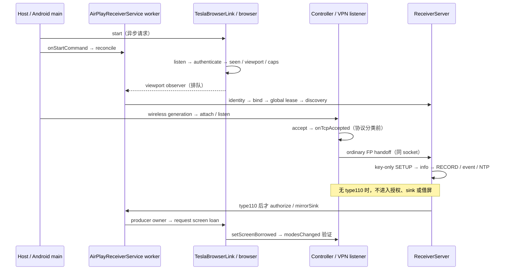
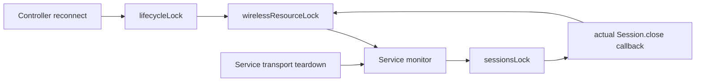

# AirPlay / CarPlay 启动与共存架构审计

2026-11-23（UTC+8）；审计源码：[9bc5dfbe033e60196662fb4d5a78ffb57a439ca2](https://github.com/uJZk/TiPlay/tree/9bc5dfbe033e60196662fb4d5a78ffb57a439ca2)。

本轮由架构负责人统筹四个子审计，覆盖 Android 编排、主监听所有权、浏览器能力发布、历史及反证。**尚未确认实机“首次无视频请求、重试成功”的根因。** 本轮新增的是跨组件生命周期与可靠性缺口，不是把原来“缺 type110”的观察改写成原因。

报告中的“witness 通过”表示已观察到该用例断言的坏状态或实际锁序，不表示软件健康、问题修复或实机验收通过。审计阶段未修改产品代码或发布 APK；后续修复状态见下节。完整 CI 仍按用户要求跳过。

本轮增加四项具体发现：退场 Service 夺取后继全局 lease、旧 browser 回调复活 ready / profile、Controller / Service 相反锁序、一次性 first-present 被队列溢出丢弃。三个 JVM 聚焦 case 和一个实际生产 JS outbox case 已观察到各自受控现象；没有一项已证明是原实机首连故障的原因。

## Beta.59 修复状态

四项问题的源码修复与健康回归已完成，A/B/C/D 实验入口和实现已撤除。
原签名 beta.59 已发布；实际 APK 与同源网页的验收和公开下载记录见 [Build](Build.md#beta59-release)，
定向验证统计见 [Testing](Testing.md#beta59-source-preparation)。下文保留基线审计的
触发条件、坏状态见证和固定源码链接，不代表当前修复版本仍有这些已修问题。

| 问题 | 当前修复与验收 |
| --- | --- |
| AA-1 | 进程级 Service authority 同一临界区保护全局 lease 与公共状态；网络/通知在外。两个真实 old/new Service 健康交错保住后继接入与状态。 |
| AA-2 | 不可复用的服务、页面、host attachment token 与状态应用/退场串行化；排队动作核对捕获的目标。八个用例含同 Host 对象复用及实际交错。 |
| AA-3 | Service 锁内只退休精确资源，锁外 close/callback；in-flight build ticket 防取消启动被后继越过。关闭早于主会话启动也安全退出。 |
| AA-4 | 当前 source/generation/epoch 的唯一绘制证明有独立有界槽，失败等 heartbeat，投递前再过滤；旧 ACK、旧失败、溢出或换源不污染后继。 |

589 个 JVM、98 个浏览器、27 个包装/站点定向用例最终通过，JVM stdout/XML
均无未捕获线程头。这是四项独立缺陷的修复证据；原实机“首试无 type110、重试成功”
的根因与 beta.59 实机首连效果仍未确认。未更改工作中的音频/MIC 路由、原媒体编码、
设备身份或 typed consent，也没有恢复提前借屏。

## 审计模型与覆盖

四组边界为：Android-orchestration、Main-ownership、Browser-profile-publication、History-contract-challenge。架构负责人独立核查共享锁图、全局 lease、旧回调可达性及每项缺陷能否产生 first → retry 的状态差异；root 负责外置聚焦执行，子审计再独立复核执行产物。

不能把以下状态混用：browser 启动已请求、网络端口已监听、browser 已认证、当前页面能力已知、CarPlay 主会话运行、屏幕借用已确认。它们分属不同线程、对象和所有权域。

| 不变量 | 实际调用链与本轮证据 | 结论 / 未覆盖 |
| --- | --- | --- |
| 已退场 Service 不能发布或夺走后继实例的全局接入权 | Service `startReceiver:134–140,273–277`；`onDestroy:458–480`；ReceiverDiscoveryInfo `attach:28–32` / `Lease.close:14–15` | 真实 old/new 生命周期 witness 已观察到后继 broker 丢失而 direct listener 存活，见 AA-1 |
| 旧 browser server 的回调不能成为新 server 的当前页面 | Tesla `reconcile:684–709`、共享 callbacks、`stopQuietly:773–781`；BrowserLinkServer `stop:164–178` / `controlBody:457–477` | 受控生产 Tesla replay 已观察到旧 ready/profile 复活，见 AA-2；未执行真实 RTC 竞态 |
| Controller 与 Service 不形成相反锁顺序 | Controller `reconnectBrowserDisplay:630–653`；Service `closeSessionsLocked:380–389`；Session `finishClose:213–251`；Controller `onSessionEnded:422–430` | 两阶段真实生产调用见证已确认反向锁边，见 AA-3；未制造永久死锁 |
| 已绘制的首帧证明不能在有界控制队列中永久丢失 | `video.js` 一次性 first-present → `app.js` `dec` → `link.js` overflow | 纯 Node 实际 production outbox witness 已观察到永久丢弃，见 AA-4；未执行 renderer / Controller |
| 一份 ReceiverConfig 属于同一完整 viewport 快照 | Service `identity:420–425` 连续读取全局 viewport；Tesla `listenViewport:477–480` 注册 / 初始回放 | 非原子构造与回放逆序风险；尚未执行交错见证，见后续边界 |
| ordinary 控制前缀的退出不改变主会话或武装重试 | 真实 VPN wrapper `onLegacyConnectionClosed:355–357` 只移除库存；Controller `onTcpAccepted:2011–2014`；旧 core TCP 对照 | 存在诊断计数副作用，但未找到 ready / grant / proof 重置；未确认首试特有迁移 |
| 当前屏幕的 first-present ACK 能到达 Controller | JS RTP / worker 解码路径携 id / epoch / generation；Hub → Sink → Engine → Session → Controller | ACK 链存在，不是“WebRTC 没有回调”；一次性消息可靠性另有 AA-4 |
| ordinary 与 CarPlay 的生命周期独立性须双向定义 | VPN 的 sessions 库存仍保留 handoff wrapper；Service detach 会关闭其原 socket | 模式切换不打断 CarPlay 不等于 CarPlay listener 退场不打断 ordinary；见待明确契约 |

## AA-1：退场 Service 的晚注册可抢占后继全局 lease

**级别：P2 可用性；受控生产生命周期复现置信度高；实机根因置信度低。**

`AirPlayReceiverService.startReceiver` 只在入口检查本实例 generation。之后读取身份、创建并启动 ReceiverServer、注册全局 discovery/handoff lease、发布状态，没有再确认该实例仍有发布权。`onDestroy` 会立即使 lifecycle 退场，但将网络清理排到同一 worker 尾部。

单实例最终会按 FIFO 关闭晚建的 receiver，不能称为永久泄漏。问题在于不同 Service 实例有各自 worker：

1. 旧实例通过入口检查，在身份读取处停住；主线程销毁旧实例，其 cleanup 排队。
2. 新实例先启动并成为全局 current lease，直接 listener 和固定监听的 broker 均可用。
3. 旧启动恢复，`ReceiverDiscoveryInfo.current.set(old)` 抢走新 lease。
4. 旧 cleanup 随后关闭自己的 lease，CAS 将 current 置空，而不是恢复新 lease。新 listener 仍存活，但固定监听的普通接入丢失。
5. 旧 cleanup 还可将进程静态 `state` 从新实例的 `listening` 覆盖成 `stopped`。

CAS 防的是旧 lease 误关“后来注册的新 lease”，没有防住“已退场的旧实例后来才注册”。单靠 provider 的 `active()` 检查也不足以维护全局发布权。

验证使用真实 old/new Service `onCreate/onStartCommand/onDestroy`、真实 ReceiverServer 和 broker；只用 passthrough ContextWrapper 在 identity IO 加确定性栅栏，没有 fake broker。实测新实例开始为 lease current、broker 200、direct OPTIONS 200、state listening；释放旧启动并等待旧 worker 终止后，同一个新实例未销毁、direct 仍 200，却失去 lease、broker 503、state stopped。1 case、0 失败 / 错误 / 跳过、0 未捕获线程头，3 个编译类与最终源码绑定。它没有运行主 CarPlay 协议、browser WebRTC 或真实 iOS。

历史：入口 / 异步销毁窗口早于 WebRTC；全局 broker 在 beta.55 加入，beta.56 增加完整 handoff。既往 direct-port 首试失败早于此组合；最新首试也已成功 FP handoff，而且普通重试不会自动重建 lease。因此它是独立启动缺陷，尚不能解释本例。

修复契约建议：发布权必须绑定进程级当前 Service / receiver authority，并在网络发布前后可验证；旧实例不能晚夺后继 lease 或状态。不要为此持 lifecycle monitor 等待网络清理。

最小修复验收：同一交错下，旧 worker 终止后新 lease 仍 current、broker / direct 均 200，公共状态仍属于新实例；旧 Service 的延迟异常与停止消息也不能覆盖新状态。

## AA-2：停止期间的旧 browser 回调可复活当前 ready / profile

**级别：P2 生命周期 / 能力一致性；受控复现置信度高；实机根因置信度低。**

Tesla 为每个 server 传入同一个无 source-generation 校验的 callbacks。`stopQuietly` 先清 readiness，再调用旧 `server.stop()`。旧 server 中已获准的回调可在这次清理之后进入 Tesla，再写回 `seen` 和 viewport；停止结束没有第二次清理或代际阻断，新 listener 尚无认证页面却可读到旧 ready / HEVC profile。

真实 RTC 的外层 `applying → browser.lock` 会使 stop 等待在途回调，不能据此声称“stop 返回后任意新调用旧 RTC callback”都可达。真正可达的是：RTC 已通过 running / owner 检查，等待 Tesla monitor；Tesla 清状态后放开 monitor；旧回调在 old.stop 等 browser lock 期间回填状态；stop 结束后旧值保留。旧 HTTP 控制路径还可能有更晚的锁外 event apply，但当前正式页面不一定走它。

生产 Tesla + 受控 ServerFactory replay 已执行，1 case、0 失败 / 错误 / 跳过、0 未捕获线程头，5 个编译类与源码绑定，并独立复核。它证明缺少代际隔离的受控后果，不是完整 BrowserLinkServer 网络 / RTC 竞态或 iOS 复现。

历史：共享 callbacks、clear-before-stop 与旧 HTTP 窗口都在 pre-WebRTC beta.5 已存在。普通 AirPlay 的首试 TEARDOWN 不会自行停止 browser；当前没有 browser restart 重叠的现场证据。

修复契约建议：每个 server callback 带不可复用 source token，在边界统一拒绝 retired source；退休与 readiness 失效应作为一个有代际约束的动作，而非仅调换一次 clear 顺序。

最小修复验收：新 server 未认证时 ready 必须为空；新页面能力建立后旧回调不能改变它或通知当前 receiver observer。代际检查与状态应用必须同属一个顺序边界，不能在 `if(current)` 与实际 delegate 之间再留退休窗口；再用真实 BrowserLinkServer 的在途控制栅栏覆盖 stop 边界。

## AA-3：Controller / VPN Service 存在条件性 ABBA 锁序

**级别：P1 条件性无界阻塞风险；生产锁序置信度高；实机根因置信度低。**

正向：Controller 显示重连持 `lifecycleLock → wirelessResourceLock`，同步调用 Service 的 `prepareWirelessDisplayReconnect` / `updatePendingWirelessDisplay`，等待 Service monitor。

反向：Service detach / 后台 transport-error 持 Service monitor，经 `closeSessionsLocked` 持 sessions monitor，同步 `session.close()`；实际 current-generation listener 最后同步进入 Controller `onSessionEnded`，等待 `wirelessResourceLock`。没有 post / enqueue 消除这条反向边。

两个可释放的生产调用 phase 已实测同一组 monitor：正向在真实 Service API 阻塞、反向在真实 current-generation Controller callback 阻塞；各自取 ThreadMXBean 栈和持锁记录，释放后 join 并清理。1 case、0 失败 / 错误 / 跳过、0 未捕获线程头，6 编译类绑定并独立复核。**未制造永久死锁，也没有用两把 fake 锁代替生产路径。**

Controller 自己 close 会先使无线 generation 失效，可能挡住自己的回调路径；Service 后台 transport-error 不先改变 Controller generation，故并不能防住本锁序。反向锁边在 beta.16 的 `572207cc9a16c0d13d287e5cd3612ea79767eb93` 引入；beta.23 只是变量改名，不能误归因。

本风险需要显示重连与主 Service 退场并发。ordinary pre110 退出只移除 legacy wrapper，不走 Service detach；主 teardown 还会关闭主事件 / 屏幕，不符合保留首试期间 CarPlay 持续正常的表现。

修复契约建议：跨所有权域的同步 close / callback 移到共同锁外，先在锁内捕获并退休精确资源，锁外关闭；同时验证旧 cleanup 不会影响新 attachment。不要仅在一个调用点换锁顺序而保留其他反向入口。

最小修复验收：现有两阶段生产调用不再显示相反持锁等待边；并发显示重连与 current-generation transport teardown 均有界结束，旧 attachment 清理仍不能关闭新 attachment 或遗漏真实会话关闭。

## AA-4：一次性 first-present 消息可被控制队列溢出永久丢弃

**级别：P2 可靠性；实际 outbox 受控复现置信度高；实机根因置信度低。**

当前 first-present 回调链完整：RTP / DataChannel 解码绘制成功 → `decoded`（streamId / epoch / videoGeneration）→ `app.js` 校验并发送 `dec` → Hub `browserDecoded` → Sink diagnostics → Engine `session.videoFrameRendered` → Controller 的 connection proof 与 display-reconnect completion。`video-ready` 不是实际首帧绘制证明。

问题是 `app.js:764–768` 将 `dec` 以普通 `latest` 入 ControlOutbox。队列溢出时 `link.js:492–496` 清空整个 queue，不转 retry；`video.js:31–37` 对同 stream / epoch 的 first-present 仅发送一次。已排队但未发送的 `dec` 因此可能永久丢失，即使画面已经可见。实际 import production `link.js` 的纯 Node 调度 witness 已执行：占满 8 个 in-flight 请求，排入 dec 与 edge events，触发 64-entry overflow，释放请求并 heartbeat，观察到 dec 没有恢复；正常负载的对照成功发送一次。1 case、0 失败，执行与生产源码绑定已独立复核，没有复制实现函数自证。这个 witness 不运行 renderer、Controller 或真实网络，证明的范围是实际 outbox 对受控输入的丢弃行为。

下游不只是统计：rendered proof 参与某些 Bluetooth 保留 / 无 tunnel fallback 判断；通常 tunnel-ready 的 handoff 不必等 rendered。丢 dec 也可能使 reconnect pending 不清。但 ordinary 首次接入 / 退出不会清 pending、重发 dec 或自动更新显示 offer，所以仍缺少“首试结束导致重试成功”的因果链，且没有现场 overflow 证据。

历史：一次性 dec 与 overflow 丢队列的组合早于 WebRTC；beta.3 已将一次证明放在 Canvas 真正绘制后。正式 WebRTC 前的 `a16f7e5a` 增加 8 个并发请求和事件版本处理，会改变压力窗口，但 beta.5 在 1 个 in-flight 被阻塞时也能形成同类丢弃。native RTP 边界没有引入此机制。

修复契约建议：first-present 必须有当前 epoch 的有界可靠送达语义，至少保留到当前控制请求成功；不要让普通 telemetry / edge overflow 无声丢掉唯一生命周期证明。

最小修复验收：相同 8-request 阻塞 / queue overflow 输入下，当前 epoch 的 dec 在释放后仍能送达；正常负载和旧 epoch / generation 的隔离保持，且不削弱 touch 恢复或现有音频故障保护槽。

## 尚未升级为已证缺陷的边界

- **Profile 原子快照与 observer 回放。** 基线 `identity:420–425` 多次读取可得到 width 来自 V1、height / codec 来自 V2 的组合；`listenViewport:477–480` 注册与初始回放未同 viewport 发布串行。两者在 beta.5 已有。普通 periodic refresh 只重取 audio formats / discovery，不会独立重算尺寸与 HEVC；但排队的完整 viewport callback 通常会修正初始混合值。初次注册时 server 往往尚为 null，不能仅凭 listener 回放顺序就称已向 iPhone 发布错误配置。Beta.59 初始构造已改为单一 `receiverViewportSnapshot`；普通 source 更新与退场受 permit 保护，但 observer 注册/初始回放的单独交错仍未建立缺陷见证，不属于本轮已修复项。
- **混合 wrapper 库存。** `updatePendingWirelessDisplay:211–219` 将任意未关 external wrapper 视为新主显示接入，包括 ordinary FP handoff wrapper。这会在已有 display reconnect pending 时阻止 resize coalescing，但尚无本例 pending 或两试间 resize 证据。CP 可见不能单独证明 pending 已清；反过来也不能将 pending 假设成事实。
- **交接后的 socket 生命周期。** handoff 后 VPN sessions 仍保存原 wrapper；主 Service detach 会关闭同一 ordinary socket。因此需要明确双向契约：ordinary 模式切换保持 CarPlay，不等于 CarPlay listener 重建必须保持 ordinary。该关系尚不能简单列为 bug，且首试现场没有主 detach 证据。

## 对当前实机问题的判断与下一步

新增审计确实找到了此前 direct-session fixture 覆盖不到的跨组件风险。没有一项已建立与当前 first → retry 的闭合因果链。尤其不能把根因改写成“关键帧”“没等时钟同步”“权限弹窗未出现”或“缺 type110”。成功重试在初始第二个 NTP 响应前就发出 type110，进一步反对通用同步等待。

历史矩阵核对 9 文件 × 6 pins：native RTP 边界六个 Android 编排文件均无差异；Readiness、FirstTcpWatchdog、WirelessConnectionProof 六版本逐字一致。这不能排除整体调度改变，但要求任何迁移归因给出新增触发条件。

优先处理已复现的生命周期隔离和锁序缺陷，将坏状态 witness 改成保留当前 owner / 正确 ready / 不持反向锁的回归断言；first-present 也应有可靠投递断言。修复这些缺陷不能自动宣称镜像首连已修好。对原问题仍应保留完整 actual sender-visible profile、Controller / Service / browser source generation 与首次 / 重试控制阶段的对应关系；当前没有新的实机 wire，用户也尚未回答是否每次从 CarPlay 返回镜像均需重试，不据此假定一次性初始化或每周期重现。

## 证据索引

- `Android-orchestration.json`：真实 Service 编排、epoch / mode 安全反证。
- `Main-ownership.json`：VPN 分类前接受、库存、同步 callback / 锁图、诊断副作用、handoff 契约。
- `Browser-profile-publication.json`：ready / profile 与 first-present 链。
- `History-contract-challenge.json` / `History-source-matrix.json`：版本矩阵、引入 pin、反证。
- `browser-replay/Execution-verification.json` / `Independent-execution-review.json`：已执行受控 Tesla replay。
- `main-lock/Execution-verification.json` / `Independent-execution-review.json`：已执行实际生产锁序见证。
- `android-retirement/`、`first-presentation-replay/`：外置 witness、root 最终执行与独立复核。

最终 JVM 三个聚焦 case 各为 1 / 0 / 0 / 0，stdout + XML 均无未捕获线程头；共 14 个选定编译类与各自最终源码、XML、Runtime 绑定。Node 1 case 直接导入实际 production outbox，正常负载对照也成立。它们不增加已发布 beta.58 的 413-case 数字。

retirement 首版有一次 fixture precondition 失败：误读 RTSP `Response.status=null`，而生产编码会输出 200；失败发生目标交错前，原源码 / XML / stdout 已独立归档。最终版本只将 broker 回复经生产编码再解析，未降低生命周期、owner、broker 503 或状态覆盖的坏状态断言。机器摘要保留该历史，不把它算成候选反证或通过。

完整测试、原始私有 wire、用户媒体解密 / 解码、设备硬解和实机 iOS 分配均不在基线审计执行范围。基线审计阶段未提交产品修复或发布 APK；后续 beta.59 见[修复状态](#remediation)，当前镜像首连根因仍开放。

## 固定源码入口

以下链接固定在审计版本，后续修复不改变本报告引用的源码。

| 边界 | 源码 |
| --- | --- |
| 接收服务启动 / 退场 | [AirPlayReceiverService.kt:134](https://github.com/uJZk/TiPlay/blob/9bc5dfbe033e60196662fb4d5a78ffb57a439ca2/common/src/main/java/com/shilapi/xcertplay/AirPlayReceiverService.kt#L134) |
| 全局普通接入登记 | [ReceiverDiscoveryInfo.kt:28](https://github.com/uJZk/TiPlay/blob/9bc5dfbe033e60196662fb4d5a78ffb57a439ca2/shared/src/main/java/com/shilapi/xcertplay/receiver/ReceiverDiscoveryInfo.kt#L28) |
| 浏览器回调 / ready | [TeslaBrowserLink.kt:593](https://github.com/uJZk/TiPlay/blob/9bc5dfbe033e60196662fb4d5a78ffb57a439ca2/common/src/main/java/com/shilapi/xcertplay/TeslaBrowserLink.kt#L593) |
| 浏览器服务停止 / 控制 | [BrowserLinkServer.kt:164](https://github.com/uJZk/TiPlay/blob/9bc5dfbe033e60196662fb4d5a78ffb57a439ca2/shared/src/main/java/com/shilapi/xcertplay/web/BrowserLinkServer.kt#L164) |
| Controller 显示重连 / 会话关闭 | [CarPlayController.kt:630](https://github.com/uJZk/TiPlay/blob/9bc5dfbe033e60196662fb4d5a78ffb57a439ca2/shared/src/main/java/com/shilapi/xcertplay/orchestration/CarPlayController.kt#L630) |
| VPN Service 会话清理 | [CarPlayVpnService.kt:380](https://github.com/uJZk/TiPlay/blob/9bc5dfbe033e60196662fb4d5a78ffb57a439ca2/shared/src/main/java/com/shilapi/xcertplay/network/CarPlayVpnService.kt#L380) |
| 主会话同步关闭 | [AirPlaySession.kt:213](https://github.com/uJZk/TiPlay/blob/9bc5dfbe033e60196662fb4d5a78ffb57a439ca2/shared/src/main/java/com/shilapi/xcertplay/airplay/AirPlaySession.kt#L213) |
| 一次性绘制证明 | [video.js:35](https://github.com/uJZk/TiPlay/blob/9bc5dfbe033e60196662fb4d5a78ffb57a439ca2/site/play/video.js#L35) |
| 绘制证明入队 | [app.js:764](https://github.com/uJZk/TiPlay/blob/9bc5dfbe033e60196662fb4d5a78ffb57a439ca2/site/play/app.js#L764) |
| 控制队列溢出 | [link.js:492](https://github.com/uJZk/TiPlay/blob/9bc5dfbe033e60196662fb4d5a78ffb57a439ca2/site/play/link.js#L492) |
